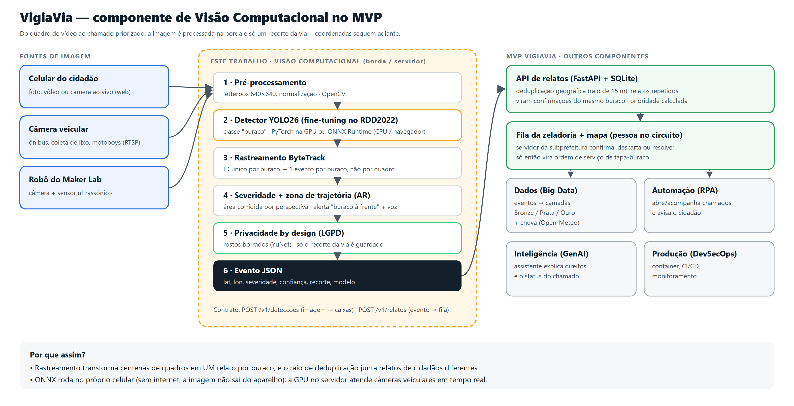
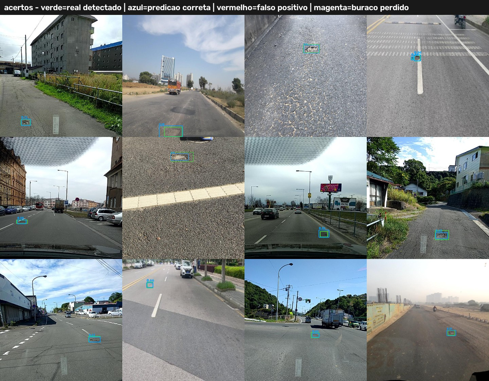
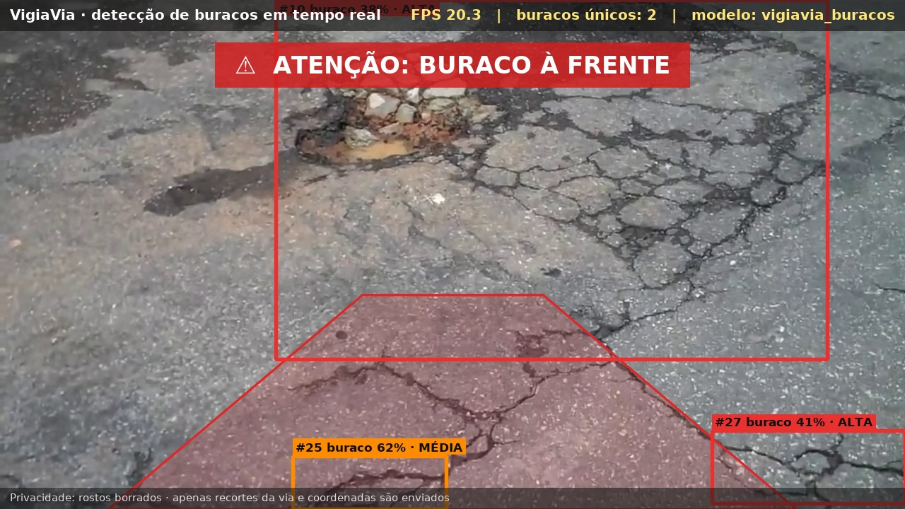
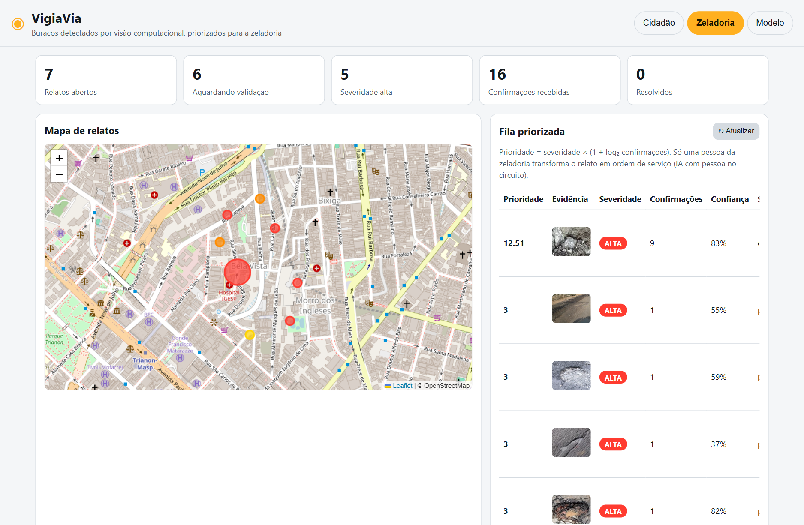

# VigiaVia — Visão Computacional para detecção de buracos em vias públicas

> Componente **Visão** da CitizenTech **VigiaVia** · FIAP Global Solution 2026.2 · Engenharia de Software 4º ano (4ES)
> Disciplina **Applied Computer Vision** — *Enxergando o mundo real* (Profs. Arnaldo Viana e Paulo Rodrigues)

O VigiaVia detecta **buracos em tempo real** a partir da câmera do celular ou de câmeras de ônibus e caminhões de
coleta, rastreia cada buraco para gerar **um único relato por buraco**, estima a severidade, alerta o condutor com uma
interface de **realidade aumentada** e envia à fila da zeladoria apenas **um recorte da via + coordenadas** — com
pessoa no circuito e privacidade desde o projeto.

| Integrante | RM |
|---|---|
| Deivison Pertel | 550803 |
| Eduardo Akira Murata | 98713 |
| Wesley Souza de Oliveira | 97874 |

**Entregáveis:** 📄 [Relatório técnico (PDF)](docs/relatorio/VigiaVia_Relatorio_Applied_Computer_Vision.pdf) ·
🎬 [Vídeo de demonstração (YouTube)](https://youtu.be/8bG2DHv848A) · [cópia MP4 720p](https://github.com/akiramrt/vigiavia-visao-computacional/blob/main/demo/VigiaVia_demo_720p.mp4) · 📓 [Notebook com saídas](notebooks/VigiaVia_Visao_Computacional.ipynb)



---

## Ficha técnica do MVP

| Item | VigiaVia |
|---|---|
| **Nome do produto** | VigiaVia — zeladoria inteligente de vias públicas |
| **Cidadão e território** | Quem circula pelas vias — motociclistas (inclusive entregadores), ciclistas, pedestres, motoristas e usuários de ônibus — e os agentes de zeladoria das subprefeituras. Piloto: centro de São Paulo (Bela Vista). |
| **Problema, em uma frase** | Buracos nas vias causam acidentes e custos, e sua identificação depende de chamados manuais, lentos, imprecisos e duplicados. |
| **Proposta de valor** | Detectar buracos automaticamente, em tempo real, com as câmeras que já circulam pela cidade, gerando um relato único, georreferenciado e priorizado por buraco — com privacidade e validação humana. |
| **Arquitetura: componentes** | Visão (este repositório: YOLO + ByteTrack + HUD de RA + API) · Dados (lakehouse) · Inteligência (GenAI) · Automação (RPA) · Produção (DevSecOps) · Físico (robô do Maker Lab) · Negócio (pitch). |
| **Fontes de dados** | RDD2022, release oficial do CRDDC'2022 (figshare) — treino/validação/teste; vídeos reais do Wikimedia Commons (CC BY/BY-SA) — teste fora da distribuição; relatos do próprio app. |
| **Modelos de IA utilizados** | YOLO26n em produção (fine-tuning Ultralytics) · YOLO26n, YOLO11n e YOLO26s comparados · ByteTrack (rastreamento) · YuNet (borragem de rostos). |
| **URL do MVP e repositório** | Este repositório · API e interface web prontas para container (`Dockerfile`); a publicação em nuvem é do componente Produção. |
| **Indicadores de impacto** | Tempo entre detecção e reparo · % de chamados duplicados evitados · buracos detectados por km rodado · precisão das detecções confirmadas pela zeladoria · quedas e sinistros nas vias monitoradas. |
| **ODS conectados** | **11** (11.2 transporte seguro; 11.3 gestão participativa) · **9** (9.1 infraestrutura de qualidade e resiliente) · **3** (3.6 reduzir mortes e lesões no trânsito). |

## Por que importa

* São Paulo recebeu **113,1 mil pedidos de tapa-buraco em 2025** (177,3 mil em 2023) e, segundo a prefeitura,
  *"um mesmo ponto pode gerar vários chamados"* (SMSUB, via BNews, 09/08/2026).
* Nas rodovias, **80% dos 2.146 pontos críticos são buracos**, e o pavimento ruim eleva em média **31,2%** o custo
  operacional do transporte (Pesquisa CNT de Rodovias 2025).

## Resultados

Dataset: **4.192 imagens** (RDD2022 oficial, 5 países, 5.997 buracos D40), split 70/15/15 por trajeto.

| Modelo | Parâmetros | Val mAP@0,5:0,95 | Teste mAP@0,5 | Teste mAP@0,5:0,95 | Inferência GPU |
|---|---|---|---|---|---|
| E1_yolo26n **(produção)** | 2.53 M | 0.255 | 0.585 | 0.259 | 3.2 ms |
| E2_yolo11n | 2.60 M | 0.244 | 0.561 | 0.249 | 2.9 ms |
| E3_yolo26s | 9.95 M | 0.264 | 0.589 | 0.260 | 4.7 ms |

* **Modelo de produção (YOLO26n)**, limiar 0.305 (máximo F1 na validação): precisão **70%**, revocação **50%** no teste.
* Velocidade: **62 FPS** de inferência em GPU (RTX 3070), **39 FPS** em CPU com ONNX; pipeline completo em vídeo 1080p (BoT-SORT + privacidade + HUD) a **18–19 FPS**.
* ONNX com NMS em paridade com o PyTorch (mAP@0,5 0,582 × 0,585); a variante fim a fim sem NMS perdeu 4,3 p.p. e foi descartada.
* Vieses medidos por país, iluminação e tamanho (`resultados/analise_teste.json`); 0% de quase-duplicatas entre teste e treino (dHash).

| Acertos no teste | Vídeo real em São Paulo (fora do treino) |
|---|---|
|  |  |



## Como executar

### 1. Ambiente
```bash
python -m venv .venv
.venv\Scripts\activate            # Linux/macOS: source .venv/bin/activate
pip install torch==2.11.0 torchvision==0.26.0 --index-url https://download.pytorch.org/whl/cu128   # GPU NVIDIA (opcional)
pip install -r requirements.txt
```

### 2. Usar o modelo treinado (sem treinar nada)
O modelo de produção já está em `modelos/vigiavia_buracos.pt` (PyTorch) e `modelos/vigiavia_buracos.onnx` (CPU/navegador).
```bash
cd src
python -m vigiavia.tempo_real --fonte 0 --mostrar                       # webcam, tecla q encerra
python -m vigiavia.tempo_real --fonte video.mp4 --saida ../demo/saida.mp4 --lat -23.5603 --lon -46.6505
cd ..
uvicorn api.main:app --port 8000                                        # API + interface web em http://localhost:8000
```
Exemplo pronto: abra `http://localhost:8000/?demo=/static/amostras/sp_bela_vista_quadro2.jpg` (detecção) ou `/?aba=zeladoria` (fila).
Na interface, *Processamento → No aparelho* roda o modelo ONNX **no navegador** (a imagem não sai do celular).

### 3. Reproduzir tudo (dados → treino → avaliação → documentação)
```bash
python scripts/01_preparar_dataset.py --out datasets/vigiavia-rdd2022            # RDD2022 oficial, só o necessário (HTTP Range)
python scripts/01b_auditar_rotulos.py --data datasets/vigiavia-rdd2022 --saida resultados/auditoria_rotulos_oficial.jpg
python scripts/02_treinar.py --data datasets/vigiavia-rdd2022/data.yaml --exp E1_yolo26n E2_yolo11n E3_yolo26s
python scripts/03_avaliar.py --data datasets/vigiavia-rdd2022/data.yaml           # comparação, limiar, vieses, severidade
python scripts/04_exportar_onnx.py --data datasets/vigiavia-rdd2022/data.yaml     # ONNX fim a fim + paridade
python scripts/05_benchmark_velocidade.py --data datasets/vigiavia-rdd2022/data.yaml
python scripts/06_baixar_videos_demo.py && python scripts/06b_processar_videos.py  # vídeos reais (Wikimedia Commons)
pip install -r requirements-dev.txt
python scripts/06c_capturar_telas.py --api http://localhost:8000                  # com a API rodando
VIGIAVIA_DATA=datasets/vigiavia-rdd2022 python scripts/08_gerar_notebook.py
python scripts/07_gerar_video_demo.py && python scripts/09_gerar_relatorio.py
pytest -q
```

### 4. Docker (CPU, ONNX)
```bash
docker build -t vigiavia-visao .
docker run -p 8000:8000 vigiavia-visao
```

## Contrato da API

| Método | Rota | Descrição |
|---|---|---|
| `GET` | `/health` | estado do serviço e do modelo |
| `GET` | `/v1/modelo` | ficha do modelo (métricas de teste, limiar, severidade, zona de trajetória) |
| `POST` | `/v1/deteccoes` | imagem (multipart) → caixas com confiança e severidade; a imagem é descartada |
| `POST` | `/v1/relatos` | evento (lat, lon, severidade, confiança, recorte opcional) → fila; relatos a < 15 m viram **confirmações** |
| `GET` | `/v1/relatos` | fila priorizada (severidade × (1 + log₂ confirmações)) |
| `PATCH` | `/v1/relatos/{id}` | validação humana: `confirmado`, `descartado` ou `resolvido` |
| `GET` | `/v1/relatos/{id}/evidencia` | recorte da via usado como evidência |

## Estrutura do repositório

```
api/                 API FastAPI + interface web (cidadão, zeladoria, ficha do modelo)
configs/             hiperparâmetros (treino.yaml), modelo/limiar em produção, calibração da severidade
docs/                relatório (HTML/PDF), diagrama de arquitetura, telas, roteiro do vídeo
modelos/             pesos finais (.pt), ONNX de produção e YuNet (terceiros, MIT)
notebooks/           notebook executado com todas as saídas
resultados/          métricas, curvas, comparação, vieses, exemplos, velocidade, tempo real
scripts/             pipeline numerado: dados → treino → avaliação → ONNX → vídeos → documentação
src/vigiavia/        detector, severidade, privacidade, HUD de realidade aumentada e modo tempo real
tests/               testes do contrato da API e da severidade (pytest)
```

## IA responsável, LGPD e segurança

* **Auditoria de dados:** antes de treinar, inspecionamos recortes dos rótulos. Isso revelou que uma redistribuição do
  RDD2022 rotulava faixas apagadas, faixas de pedestre e bueiros como "pothole"; passamos a usar a release oficial.
* **Vieses medidos:** precisão/revocação por país, iluminação e tamanho do buraco (`resultados/analise_teste.json`).
* **Pessoa no circuito:** a IA só sugere; a zeladoria confirma, descarta ou resolve cada relato.
* **Minimização (LGPD):** a API não guarda imagens enviadas; o evento leva só o recorte da via; rostos são borrados (YuNet);
  no modo "no aparelho", a imagem nem sai do celular.
* **Segurança:** sem segredos no código; container com usuário não root; instalação automática de pacotes do
  Ultralytics desativada em tempo de execução (`YOLO_AUTOINSTALL=False`).

## Licenças e créditos

* Código: **AGPL-3.0** (compatível com o Ultralytics, AGPL-3.0).
* Dados: **RDD2022** — Arya et al., 2022 (arXiv:2209.08538), release oficial do CRDDC'2022 (figshare, CC BY 4.0;
  repositório oficial indica CC BY-SA 4.0 — seguimos os termos mais restritivos). Os pesos treinados são distribuídos
  com a mesma atribuição.
* YuNet (OpenCV Zoo) — MIT (`modelos/terceiros/YUNET_LICENSE.txt`).
* Vídeos de teste (Wikimedia Commons): [Buraco na rua Sílvia, 276 (Bela Vista).webm](https://commons.wikimedia.org/wiki/File%3ABuraco_na_rua_S%C3%ADlvia%2C_276_%28Bela_Vista%29.webm) — Daniel Fraga, CC BY 3.0; [Pothole.ogv](https://commons.wikimedia.org/wiki/File%3APothole.ogv) — Amuzujoe, CC BY-SA 4.0; [Cars Moving into pothole.webm](https://commons.wikimedia.org/wiki/File%3ACars_Moving_into_pothole.webm) — Amuzujoe, CC BY-SA 4.0; [Rainwater-Filled Potholes on a Community Road.webm](https://commons.wikimedia.org/wiki/File%3ARainwater-Filled_Potholes_on_a_Community_Road.webm) — Knowledge and philosophy, CC BY-SA 4.0
